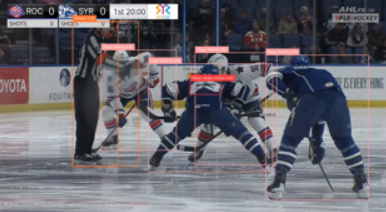

# Hockey Video Analyzer

This project uses a computer vision pipeline for analyzing hockey broadcast footage. It detects players, tracks them across frames, and assigns team labels to produce an annotated hockey video.

The notebook includes the original training workflow, but the demo output was generated from a saved RF-DETR checkpoint. Large checkpoints and raw videos are excluded from the repository.

## Demo

[Annotated demo video](Demo/demo_output.mp4)

## Project Overview

This project uses RF-DETR for hockey player detection, SAM2 for player segmentation and tracking, OpenCV for video processing and annotation, Prototype based team classification to group players by jersey appearance and Python for the pipeline development. I am also working on a jersey number detection system that utilizes a ResNet18 based digit classifier trained on jersey crops so that tracked players can be linked to their roster number. 

## Pipeline

The pipeline is as follows, input hockey video -> RF-DETR player detection -> SAM2 player tracking -> jersey crop extraction -> Prototype based team classification -> tracker level smoothing -> annotated output video
